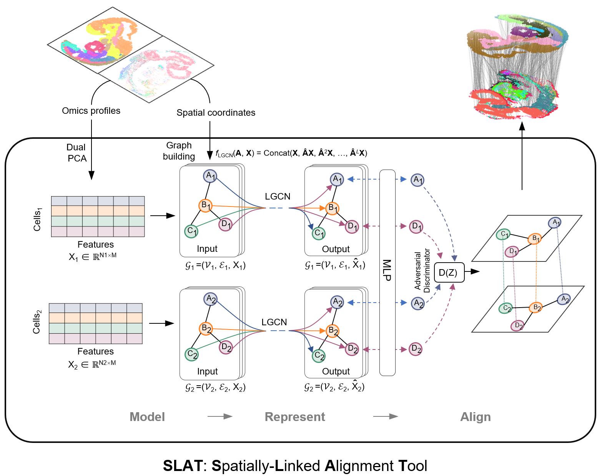
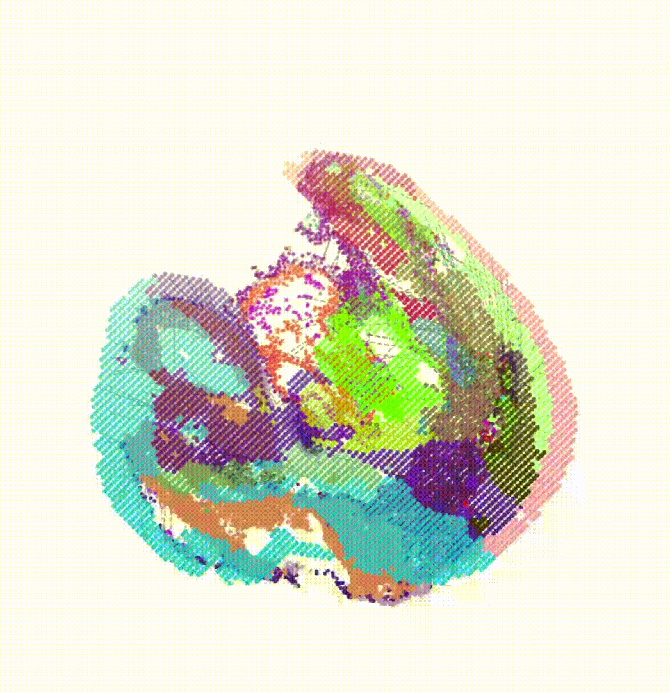

[](https://github.com/gao-lab/SLAT/stargazers)
[](https://pypi.org/project/scslat)
[](https://pepy.tech/project/scSLAT)
[](https://github.com/gao-lab/SLAT/actions/workflows/build.yml)
[](https://slat.readthedocs.io/en/latest/?badge=latest)
[](https://opensource.org/licenses/MIT)


# scSLAT: single cell spatial alignment tools

**scSLAT** package implements the **SLAT** (**S**patial **L**inked **A**lignment **T**ool) model to align single cell spatial omics data.

Please check our paper ***Spatial-linked alignment tool (SLAT) for aligning heterogenous slices*** on [*Nature Communications*](https://www.nature.com/articles/s41467-023-43105-5).



## Directory structure

```
.
├── scSLAT/                  # Main Python package
├── env/                     # Extra environment
├── data/                    # Data files
├── evaluation/              # SLAT evaluation pipeline
├── benchmark/               # Benchmark pipeline
├── case/                    # Case studies in paper
├── docs/                    # Documentation files
├── resource/                # Other useful resource
├── pyproject.toml           # Python package metadata
└── README.md
```

## [Tutorial](https://slat.readthedocs.io/en/latest/tutorials.html)
Tutorial of `scSLAT` is [here](https://slat.readthedocs.io/en/latest/tutorials.html), if you have any question please open an issue on github




## Installation

### PyPI
> **Note**
> Installing `scSLAT` within a new [conda environment](https://conda.io/projects/conda/en/latest/user-guide/tasks/manage-environments.html) is recommended.

> **Warning**
> Old NVIDIA driver may raise error.

First, we create a clean environment and install `scSLAT` from PyPI. Then we also need install dependencies for `pyg` manually via `install_pyg_dependencies`.

```bash
conda create -n scSLAT python=3.11 -y && conda activate scSLAT
pip install scSLAT
install_pyg_dependencies
```

### Docker
You can pull the docker image directly from [Docker Hub](https://hub.docker.com/repository/docker/huhansan666666/slat) or refer to the [`Dockerfile`](Dockerfile) to build it.

``` bash
docker pull huhansan666666/slat:latest
```

### Development version
For development purpose, clone this repo and install:

```bash
git clone git@github.com:gao-lab/SLAT.git && cd SLAT
pip install -e ".[dev,docs]"
install_pyg_dependencies
```


## Appendix
1. The unit of runtime is seconds (s).
2. Executed on GPU.
